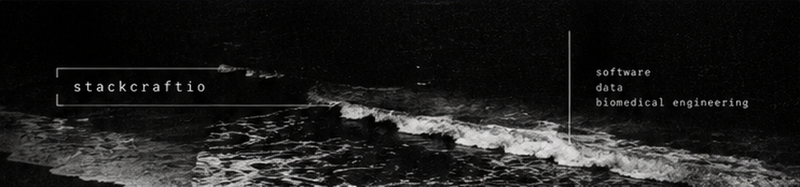
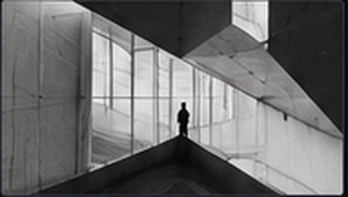
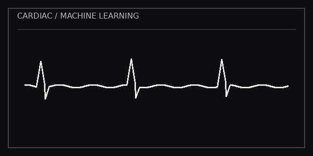
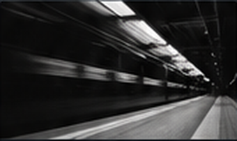
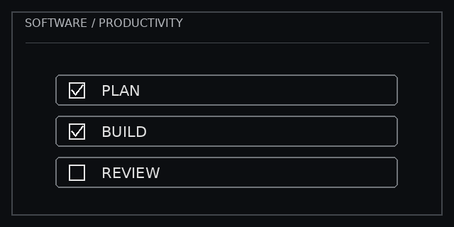
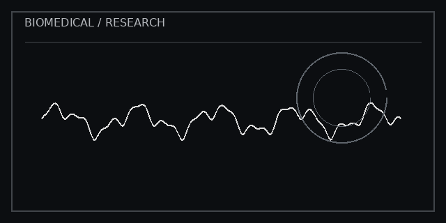

 

<!-- Add your real LinkedIn URL below when ready:

-->

---

### `01. ── hi, i'm stackcraftio` ✧

<table>
<tr>
<td width="70%" valign="top">

just a little corner of the internet where I keep things I've built.

mostly experimenting with code, trying out ideas and occasionally figuring out why something that worked yesterday suddenly doesn't.

some projects are practical, some are just for fun. there's always something new to learn.

<em>// somewhere between curiosity and figuring things out.</em>

</td>
<td width="30%" valign="top" align="center">

<code>building things</code> <code>learning as i go</code>
</td>
</tr>
</table>

---

### `02. ── tech stack` ✧

<table>
<tr>
<td width="50%" valign="top">

languages

 

data & analysis

</td>
<td width="50%" valign="top">

frameworks & tools

 

engineering & other

</td>
</tr>
</table>

---

### `03. ── featured projects` ✧

<table>
<tr>
<td width="25%" valign="top">

 <b><a href="https://github.com/stackcraftio/PulsePredict">PulsePredict</a></b>
 Cardiovascular risk prediction with machine learning, FastAPI and Streamlit.
  ● Python
</td>
<td width="25%" valign="top">

 <b><a href="https://github.com/stackcraftio/SpendScope">SpendScope</a></b>
 Personal finance dashboard with Flask, SQLite and pandas.
  ● Python
</td>
<td width="25%" valign="top">

 <b><a href="https://github.com/stackcraftio/taskflow">TaskFlow</a></b>
 Task management web app with Flask and SQLite.
  ● Python
</td>
<td width="25%" valign="top">

 <b>Wearable ECG Classification</b>
 Third-year dissertation: On-Device Classification of Wearable ECG Signals.
  ◌ In progress
</td>
</tr>
</table>

---

### `04. ── currently building` ✧

`wearable ECG classification`　·　`machine learning`　·　`software projects`

More projects and research notes will be added here as they develop.

---

### `05. ── activity` ✧

GitHub's live contribution calendar appears below the pinned repositories on my profile.

---

*always learning. always building.*

